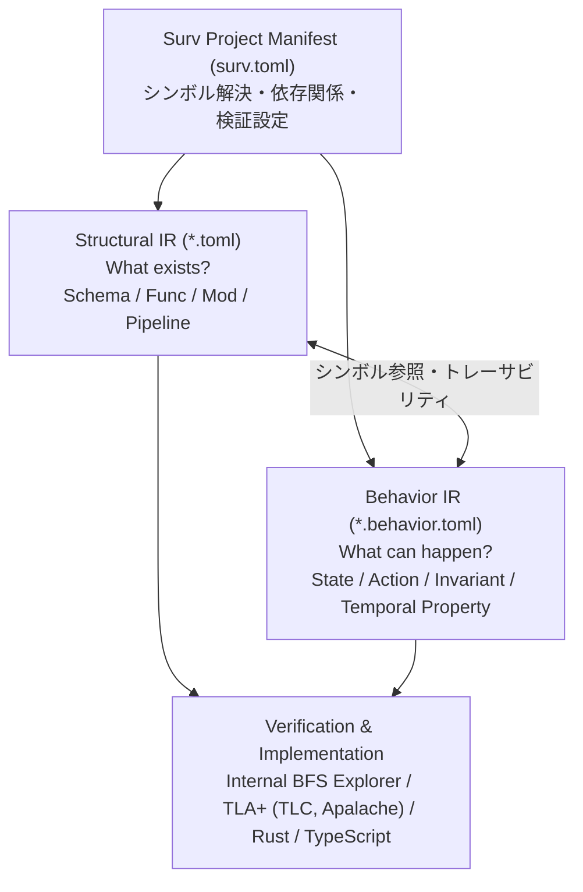
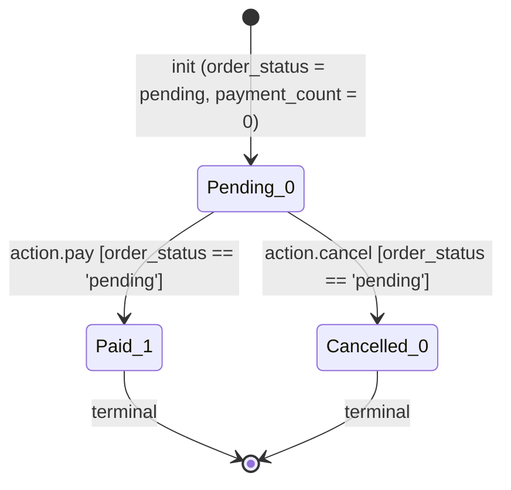
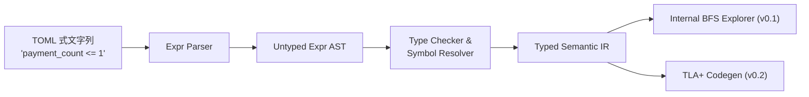
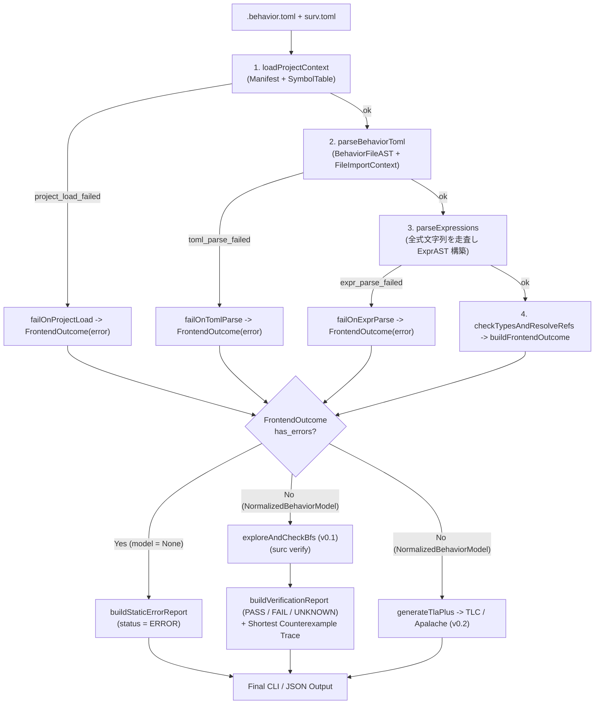

# Surv Behavior IR Specification v0.1 (Draft)

- **Status**: Proposal / Draft v0.1
- **Last Updated**: 2026-11-18
- **Compatibility**: Surv IR v1.1 (`Spec-Surv-IR-v1.1.md`)

---

## Table of Contents

1. [概要](#1-概要)
2. [基本設計方針](#2-基本設計方針)
3. [機能要件](#3-機能要件)
4. [構文仕様（MVP v0.1）](#4-構文仕様mvp-v01)
5. [形式意味論](#5-形式意味論)
6. [式言語（Expression Language）の要件](#6-式言語expression-languageの要件)
7. [Surv IR（Structural IR）との統合要件](#7-surv-irstructural-irとの統合要件)
8. [検証エンジンの要件](#8-検証エンジンの要件)
9. [非機能要件](#9-非機能要件)
10. [開発フェーズ](#10-開発フェーズ)
11. [MVP（v0.1）受け入れ基準](#11-mvpv01受け入れ基準)
12. [設計上の確定事項・トレードオフ](#12-設計上の確定事項トレードオフ)
13. [総括とアーキテクチャ方針](#13-総括とアーキテクチャ方針)

---

## 1. 概要

**Behavior IR** は、Surv IR で定義されたシステムの振る舞いを、**状態（State）・状態遷移（Action）・不変条件（Invariant）・時間的性質（Temporal Property）**として宣言的に記述するための中間表現である。

既存の Surv IR（Structural IR）がシステムの**静的構造（What exists?）**を記述するのに対し、Behavior IR はその構造上で起こり得る**動的な振る舞い（What can happen?）**を記述する。

### 1.1 設計上の位置付け



Behavior IR は TLA+ の代替を目指すものではない。内部の有限状態探索器（BFS）で即座に反例検査ができると同時に、TLA+（TLC / Apalache）などの形式手法バックエンドへも変換可能な、より高水準の設計記述を提供する。ただし、TLA+ の全表現能力を再現することも目的としない。

### 1.2 主要目標

1. **独立性** — 既存の Surv IR v1.1 仕様とファイルを一切変更せずに導入できる。
2. **参照可能性** — `schema.*`、`func.*`、`mod.*` を既存の名前解決規則で参照できる。
3. **形式性** — 状態と遷移に曖昧さのない数学的意味論を与える。
4. **検証可能性** — 到達可能性、不変条件（Invariant）、デッドロックなどを機械的に検査できる。
5. **並行性・非決定性** — 処理の順序が固定されないシステムや競合状態を記述できる。
6. **実装非依存性** — 特定のプログラミング言語・フレームワーク・DB に依存しない。
7. **段階的導入** — 単一バイナリ（`surc`）内の小規模な状態機械検査から始め、段階的に分散システムの形式検証まで拡張できる。

### 1.3 非目標

初期版（v0.1）では次を対象外とする：

- 汎用プログラミング言語の実装
- 実際の業務処理コードの完全自動生成
- 任意の TLA+ 仕様との双方向・完全相互変換
- 実装コードの正しさの自動定理証明
- 実時間性能や物理的時間制約（リアルタイムクロック）の厳密な検証
- 無限状態空間における一般的な性質の決定

> **重要:** 有限モデルにおける検証結果（`PASS`）と、現実のシステム全体の無条件の正しさは明確に区別しなければならない。

---

## 2. 基本設計方針

### 2.1 Structural IR と Behavior IR の関係

両者は上下関係ではなく、**同じシステムを異なる観点から記述する2つの射影**とする。

| 観点 | Structural IR (`*.toml`) | Behavior IR (`*.behavior.toml`) |
| :--- | :--- | :--- |
| **データ** | `Schema`（データ構造の型） | `State variable`（時間変化するシステム状態） |
| **操作** | `Func`（入出力変換・関数単位） | `Action`（観測可能な原子的状態遷移） |
| **組織化** | `Mod`（モジュール構成） | `Behavior`（状態遷移系） |
| **処理順序** | `Pipeline`（設計上の基本データフロー） | `Transition relation`（非決定的遷移関係） |
| **制約** | 型・参照整合性 | `Invariant`（到達可能状態での不変条件） |
| **時間的性質** | 原則対象外 | `Safety` / `Liveness` / `Deadlock-freedom` |
| **実装対応** | `impl.*` / `.surv/mapping.toml` | `ref = "func.*"` を通じた間接対応 |

ここで重要なのは、**`Func` と `Action` を同一視しない**ことである。
例えば `func.processPayment` は実装上の関数を抽象化するが、`action.paymentSucceeded` や `action.paymentFailed` はシステムに観測される1つの原子的な状態変化を記述する。1つの `Func` が複数の `Action`（成功・失敗・リトライ等）に対応する場合も、複数の `Func` が1つの `Action` を構成する場合もある。

### 2.2 ファイル構成

```text
project/
├── surv.toml
├── design/
│   ├── order.toml
│   ├── payment.toml
│   └── inventory.toml
└── behavior/
    ├── order.behavior.toml
    ├── payment.behavior.toml
    └── checkout.behavior.toml
```

- Behavior IR は `.behavior.toml` を標準拡張子とする（または `[meta] ir = "surv-behavior"` ヘッダで識別する）。
- 1ファイルに複数の `[behavior.*]` を記述できる。
- 1つの Behavior は複数の Structural IR ファイルのシンボルを参照できる。
- 同一の `Schema` や `Func` を複数の Behavior が共有できる。

### 2.3 設計の最小単位

Behavior IR の中心概念は `behavior` とする。1つの Behavior $B$ は次の5つ組で定義される：

$$B = (V, I, A, P, F)$$

| 記号 | 意味 | MVP (v0.1) での扱い |
| :---: | :--- | :--- |
| $V$ | 状態変数（State Variables）と定義域の集合 | **必須（P0）** |
| $I$ | 初期状態（Initial States）を定義する述語 | **必須（P0）** |
| $A$ | 許可された状態遷移（Actions）の集合 | **必須（P0）** |
| $P$ | 検証対象の性質（Invariants / Terminal / Temporal Properties） | **Invariant・Terminal は P0**、Liveness は P1 |
| $F$ | 公平性（Fairness）など実行に関する仮定 | P1 で導入 |

---

## 3. 機能要件

優先度は **P0（MVP v0.1 必須）**、**P1（初期拡張 v0.2）**、**P2（将来 v0.3+）** とする。

| ID | 機能 | 優先度 |
| :--- | :--- | :---: |
| **BR-001** | Behavior の宣言と管理（`[behavior.<name>]`） | P0 |
| **BR-002** | 状態変数と有界型の定義（`[behavior.<name>.vars]`） | P0 |
| **BR-003** | 初期状態の定義（`[behavior.<name>.init]`） | P0 |
| **BR-004** | Action による原子的状態遷移（`[behavior.<name>.action.<act>]`） | P0 |
| **BR-005** | Guard（遷移発火条件）の評価 | P0 |
| **BR-006** | Invariant（不変条件）と Terminal（終端状態）の定義・検査 | P0 |
| **BR-007** | Structural IR シンボル（`mod.*`, `func.*`, `schema.*`）の参照解決 | P0 |
| **BR-008** | 内部エンジンによる有限状態空間の探索（BFS） | P0 |
| **BR-009** | 最短反例トレース（Counterexample Trace）の出力（Text / JSON） | P0 |
| **BR-010** | 並行実行・非決定的分岐の探索 | P0 |
| **BR-011** | TLA+ へのコード生成・TLC / Apalache 連携 | P1 |
| **BR-012** | Liveness（活性：`eventually`, `leads_to`）の記述と検証 | P1 |
| **BR-013** | Fairness（弱公平性 `wf` / 強公平性 `sf`）の指定 | P1 |
| **BR-014** | 複数 Behavior の合成（Composition） | P1 |
| **BR-015** | 実装との振る舞いドリフト検出 | P1 |
| **BR-016** | 時間・リトライ・障害注入モデル | P2 |
| **BR-017** | 抽象モデルと詳細モデルの Refinement 検証 | P2 |

---

### 3.1 Behavior（`[behavior.<name>]`）

Behavior は1つの独立した状態遷移系を表す。

```toml
[behavior.order_lifecycle]
description = "Order and payment lifecycle"
owner = "mod.order_api"
terminal = "order_status == 'paid' or order_status == 'cancelled'"
```

- **`description`**: 人間向けの説明。
- **`owner`**（任意）: 対応する Structural IR の `mod.*` への参照。指定した場合は実在するモジュールであることを検証する。
- **`terminal`**（任意）: 正常な完了状態（終端状態）を表すブール式。デッドロック検査において、`terminal` が真である状態から有効な遷移がなくてもデッドロック（異常停止）とはみなさない。

---

### 3.2 State Variable（`[behavior.<name>.vars]`）

現在のシステム状態を表す変数集合と、その型（および有限定義域）を定義する。

```toml
[behavior.order_lifecycle.vars]
order_status = "enum(pending, paid, cancelled)"
payment_count = "int(0..5)"
retry_allowed = "bool"
```

#### サポートする型（v0.1）

| 型表記 | 意味 | 有限化の扱い |
| :--- | :--- | :--- |
| `bool` | 真偽値（`true`, `false`） | 要素数 2 |
| `enum(a, b, c)` | 名前付き列挙値 | 要素数 $N$ |
| `int(min..max)` | 有界整数（閉区間 `[min, max]`） | 要素数 $\text{max} - \text{min} + 1$ |
| `int` | 整数（範囲未指定） | `[behavior.<name>.check]` の `bounds` または `max_states` で制限 |
| `set(T)` / `schema.*` | 有限集合・Schema 型参照（拡張） | 設定されたドメイン上限に従う |

> **設計原則（State ≠ Schema）:**
> `schema.Order` はデータ構造のレコード型を定義するが、`order_status` はある時点でのシステムの状態変数を表す。状態空間爆発を防ぐため、検証モデルに必要な状態変数のみを抽出・抽象化して宣言することを推奨する。

---

### 3.3 Initial State（`[behavior.<name>.init]`）

探索の起点となる初期状態を定義する。

```toml
[behavior.order_lifecycle.init]
order_status = "'pending'"
payment_count = 0
retry_allowed = true
```

- すべての状態変数に対して初期値が決定されなければならない（未初期化変数は静的エラー）。
- 型が `enum(...)` の変数に対しては、文字列リテラル `"'pending'"` と列挙子名 `"pending"` のどちらの記法も同一の列挙値として受理する。
- 将来拡張（P1）では、`init_predicate` による複数初期状態（例: `order_status in {'pending', 'cancelled'}`）もサポートする。

---

### 3.4 Action（`[behavior.<name>.action.<name>]`）

ある状態 $s$ から次の状態 $s'$ への許可された原子的遷移を定義する。

```toml
# 1行インラインテーブル形式
[behavior.order_lifecycle.action.pay]
ref = "func.processPayment"
guard = "order_status == 'pending'"
update = { order_status = "'paid'", payment_count = "payment_count + 1" }

# またはサブテーブル形式（更新変数が多い場合に推奨）
[behavior.order_lifecycle.action.cancel]
ref = "func.cancelOrder"
guard = "order_status == 'pending'"

[behavior.order_lifecycle.action.cancel.update]
order_status = "'cancelled'"
```

#### 意味論的ルール

$$\text{Pay}(s, s') \iff s.\text{order\_status} = \text{pending} \;\land\; s'.\text{order\_status} = \text{paid} \;\land\; s'.\text{payment\_count} = s.\text{payment\_count} + 1 \;\land\; s'.\text{retry\_allowed} = s.\text{retry\_allowed}$$

1. **原子性（Atomicity）**: `update` に記述されたすべての変数変更は、1回の不可分な状態遷移として同時に適用される。
2. **同時評価（Simultaneous Evaluation）**: `update` のすべての右辺式は、**更新前の状態 $s$** において評価される（記述順に依存しない）。
3. **フレーム条件（Frame Condition / `UNCHANGED`）**: `update` に記載されなかった状態変数は、遷移前後で値を維持する（$s'.v = s.v$）。
4. **非決定性（Non-determinism）**: ある状態 $s$ で複数の Action の `guard` が同時に `true` である場合、検証器はいずれの Action が発火する分岐もすべて探索する。Action のファイル上の記述順は実行順序を意味しない。
5. **定義域制約（v0.1 は Overflow-as-Violation に固定）**: `update` の評価結果が有界型（例: `int(0..3)`）の範囲外となる場合、v0.1 では暗黙の遷移ブロックは行わず、**常に検証失敗（`violation_kind = "overflow"`）として反例報告する**。上限で遷移を発火させたくない場合は、`guard`（例: `guard = "x < 3"`）で明示する。これにより、Action の有効性（Enabledness）は常に `guard` の真偽のみで一意に定まる。

---

### 3.5 Invariant（`[behavior.<name>.invariant.<name>]`）

初期状態およびすべての到達可能な状態 $s$ で常に真（`true`）でなければならない条件を定義する。

```toml
[behavior.order_lifecycle.invariant.no_double_payment]
expr = "payment_count <= 1"
severity = "error"
```

- `expr` は副作用を持たないブール式でなければならない。
- 初期状態 $s_0$ を含むすべての到達可能状態で評価され、`false` となる状態が見つかった時点でそこに至る最短経路（反例トレース）を生成する。
- `severity` は `"error"`（デフォルト）または `"warning"`。

---

### 3.6 Temporal Property（時間的性質：P1）

Invariant（Safety:「悪いことが決して起きない」）に加え、P1 では Liveness（「良いことがいつか必ず起きる」）と Fairness（公平性）を導入する。

```toml
[behavior.order_lifecycle.property.eventually_resolved]
kind = "liveness"
expr = "eventually(order_status != 'pending')"
fairness = ["wf(pay)", "wf(cancel)"]
```

---

## 4. 構文仕様（MVP v0.1）

### 4.1 完全な例：注文・決済ライフサイクルモデル

以下は標準 TOML v1.0 に完全準拠した `.behavior.toml` の記述例である。

```toml
# behavior/order.behavior.toml
package = "backend"
namespace = "app.orders"

[meta]
ir = "surv-behavior"
name = "order_behavior"
version = "0.1.0"

[behavior.order_lifecycle]
description = "Order and payment lifecycle"
owner = "mod.order_api"
terminal = "order_status == 'paid' or order_status == 'cancelled'"

[behavior.order_lifecycle.vars]
order_status = "enum(pending, paid, cancelled)"
payment_count = "int(0..3)"

[behavior.order_lifecycle.init]
order_status = "pending"
payment_count = 0

[behavior.order_lifecycle.action.pay]
ref = "func.processPayment"
guard = "order_status == 'pending'"
update = { order_status = "'paid'", payment_count = "payment_count + 1" }

[behavior.order_lifecycle.action.cancel]
ref = "func.cancelOrder"
guard = "order_status == 'pending'"
update = { order_status = "'cancelled'" }

[behavior.order_lifecycle.invariant.no_double_payment]
expr = "payment_count <= 1"
severity = "error"

[behavior.order_lifecycle.invariant.no_paid_cancellation]
expr = "not (order_status == 'cancelled' and payment_count > 0)"
severity = "error"

[behavior.order_lifecycle.check]
max_states = 10000
max_depth = 100
check_deadlock = true
```

### 4.2 状態遷移グラフと Guard 欠落時の反例シナリオ

上記の正常モデルでは、初期状態 `(pending, 0)` から `pay` または `cancel` が非決定的に選択され、到達可能状態は以下の3状態で収束する：



一方、もし設計ミスにより `action.pay` の `guard = "order_status == 'pending'"` を書き忘れた（または緩めすぎた）場合：

1. `Initial`: `(order_status = pending, payment_count = 0)`
2. `Step 1 (action.pay)`: `(order_status = paid, payment_count = 1)`
3. `Step 2 (action.pay)`: `(order_status = paid, payment_count = 2)` → **`invariant.no_double_payment` (`payment_count <= 1`) に違反！**

このように、**「Structural IR の型・関数の入出力は完全に整合しているにもかかわらず、状態遷移のガード条件の不備によってシステム全体が不正状態に陥る」** バグを機械的に検出できるのが Behavior IR の核心的価値である。

---

## 5. 形式意味論

### 5.1 状態空間と遷移関係

状態変数集合を $V$、各変数 $v \in V$ の定義域を $\text{Domain}(v)$ とすると、状態空間 $S$ は直積集合として定義される：

$$S = \prod_{v \in V} \text{Domain}(v)$$

各 Action $A_i$ はガード述語 $G_i(s)$ と更新関数 $U_i(s)$ によって定まる二項関係 $A_i \subseteq S \times S$ であり、システム全体の遷移関係 $\text{Next}(s, s')$ は全 Action の論理和（選言）となる：

$$\text{Next}(s, s') \iff \bigvee_{i=1}^{n} A_i(s, s')$$

### 5.2 実行トレース

初期状態述語を $I(s)$ とすると、長さ $k$ の有限実行トレース $\sigma = s_0, s_1, \dots, s_k$ は次を満たす状態列である：

$$I(s_0) \;\land\; \forall j \in \{0, \dots, k-1\},\; \text{Next}(s_j, s_{j+1})$$

### 5.3 検査対象の4分類

| 性質 | 問い | 判定条件 |
| :--- | :--- | :--- |
| **Safety (Invariant)** | 悪いことが決して起きないか | すべての到達可能状態 $s$ で $\text{Inv}(s) = \text{true}$ |
| **Deadlock-freedom** | 意図せず遷移不能になっていないか | 到達可能状態 $s$ で有効な Action が存在しないならば $\text{Terminal}(s) = \text{true}$ |
| **Reachability** | 各 Action や目標状態に到達可能か | 死んだ Action（一度も発火しない遷移）が存在しないか |
| **Liveness (P1)** | 良いことがいつか必ず起きるか | 公平性仮定 $F$ を満たすすべての無限トレースで時間論理式が成立 |

---

## 6. 式言語（Expression Language）の要件

`guard`、`update`、`invariant.expr`、`terminal` に記述される文字列は、Python や JavaScript ではなく、**Behavior IR 固有の純粋・決定的な型付き式言語**として定義する。

### 6.1 MVP（v0.1）の演算子とリテラル

| 分類 | 構文 | 備考 |
| :--- | :--- | :--- |
| **リテラル** | `true`, `false`, `0`, `42`, `'pending'` | 文字列・Enum リテラルはシングルクォート `'...'`（TOML 文字列とのエスケープ衝突回避のため） |
| **論理演算** | `and`, `or`, `not`, `implies` (`=>`) | 短絡評価・ブール型のみ |
| **比較演算** | `==`, `!=`, `<`, `<=`, `>`, `>=` | 同一型の値同士のみ比較可能 |
| **集合・所属** | `in`（例: `order_status in {'pending', 'paid'}`） | 有限集合リテラルに対する所属判定 |
| **算術演算** | `+`, `-`, `*` | 整数型のみ |
| **条件式** | `if <cond> then <e1> else <e2>` | `update` 内での条件付き更新に利用可能 |
| **参照** | `var_name`, `record.field` | 宣言済み状態変数のみ参照可能 |

※ 任意の外部関数呼び出し、I/O、乱数、動的コード実行は一切禁止する。

### 6.2 内部コンパイルパイプライン

TOML 内の式文字列を直接文字列置換で変換するのではなく、専用の式パーサで型付き Semantic AST に変換する：



### 6.3 静的型検査ルール

`surc check` / `surc verify` 実行時に、探索開始前に以下を静的検証する：

1. **未宣言変数の参照禁止**: `[behavior.<name>.vars]` にない識別子の参照はエラー。
2. **型不一致の禁止**: `int` と `enum` の比較（`payment_count == 'pending'` 等）や、異なる `enum` 型間の比較はエラー。
3. **Enum 列挙子の妥当性検査**: `order_status == 'shipped'` のように、`enum(pending, paid, cancelled)` に存在しない列挙子リテラルは静的エラーとして検出する。
4. **述語型の強制**: `guard`、`invariant.expr`、`terminal` の評価結果型は必ず `bool` でなければならない。
5. **代入型の整合性**: `update` の各キーは宣言済み状態変数であり、右辺式の型はその変数の型と一致しなければならない。

---

## 7. Surv IR（Structural IR）との統合要件

### 7.1 シンボルテーブルと名前解決の共有契約

Behavior IR 独自の名前解決器は作らず、既存の `Manifest`・`ProjectAST`・`SymbolTable`・`FileImportContext` による名前解決機構をそのまま共有する。

```toml
package = "orders"
namespace = "ecom.orders"
import = ["payments as pay"]

[behavior.order_lifecycle]
owner = "mod.order_service"

[behavior.order_lifecycle.action.pay]
ref = "pay.func.processPayment"
```

- **名前解決への入力契約**:
  1. **`SymbolTable`**（各 `SymbolEntry` の所属 `package`, `namespace`, `local_name`, 正規化 `fq_name` を保持）
  2. **`FileImportContext`**（当該 `.behavior.toml` の `self_package`, `namespace`, および `import = ["pkg as alias"]` から構築した `ImportEntry` リスト）
  3. **`Option<&Manifest>`**（パッケージ間の `depends` 宣言検査 `check_package_dependency` に使用）
- これにより、別パッケージに同名の `func.processPayment` が存在する場合の曖昧性検出や、未宣言パッケージ依存エラー（`E_UNDECLARED_DEPENDENCY`）が Structural IR と完全に同一の規則で判定され、解決後の正規 `fq_name` が `NormalizedBehaviorModel` に格納される。
- `surc refs func.processPayment surv.toml` や `surc inspect mod.order_service surv.toml` を実行した際、関連する `behavior.*` / `action.*` も逆引き参照として辿れるようにする。

### 7.2 `surv.toml` マニフェスト拡張

既存の `surv.toml` にオプショナルなフィールドとして `behavior_root` と `[verification]` を追加可能とする（省略時は後方互換で動作し、`ir_root` 内の `*.behavior.toml` も自動認識する）：

```toml
[project]
name = "ecommerce"

[paths]
ir_root = "design"
behavior_root = "behavior"

[verification]
backend = "internal"
default_max_states = 50000
default_max_depth = 100
```

---

## 8. 検証エンジンの要件

### 8.1 アーキテクチャ構成と段階的短絡（Early-Exit）経路

`surv.toml` の破損や `.behavior.toml` の TOML 構文エラーでは後続の `BehaviorFileAST` や型検査結果を構築できない。そのためフロントエンドの各段階（プロジェクト読込・TOML パース・式/型/参照検査）は失敗時に診断付きの `FrontendOutcome(has_errors = true, model = None)` へ直接短絡し、**AST や `NormalizedBehaviorModel` を要求せず BFS 探索器もバイパスして `status = ERROR` の `VerificationReport` を生成する**。



### 8.2 検証ステータスと終了コード

| ステータス | 意味 | CLI 終了コード |
| :--- | :--- | :---: |
| **`PASS`** | 指定された有限状態空間（または深さ）を完走し、すべての Invariant・Deadlock 条件を満たした | `0` |
| **`FAIL`** | Invariant 違反、Deadlock、または値域オーバーフローの反例が見つかった | `1` |
| **`UNKNOWN`** | 反例は見つからなかったが、`max_states` 等の探索上限に達して未探索状態が残った | `2` |
| **`ERROR`** | `surv.toml` 読み込み失敗、構文エラー、型検査エラー、または未解決の Surv シンボル参照が存在する | `1` |

> **重要:** `max_states` や `max_depth` に到達して探索を打ち切った場合、決して `PASS` を返してはならない（必ず `UNKNOWN` とし、探索済み状態数と未展開キュー数を併記する）。

### 8.3 最短反例の保証規則（深さ同期2フェーズ BFS）とトレース表現

#### 1. 最短ステップ保証のための検査順序（Level-Synchronous Two-Phase BFS）
同じ深さ $d$ のフロンティアに状態 $A$ と状態 $B$ があり、「$A$ からの Action 発火で深さ $d+1$ の範囲外オーバーフローが起きる（ステップ数 $d+1$）」一方で、「状態 $B$ 自体が Invariant 違反または Deadlock を起こしている（ステップ数 $d$）」ケースを考える。$A$ の遷移展開中に即座に停止すると、より短い $B$（長さ $d$）を見逃して長さ $d+1$ の反例を返してしまう。

これを防ぎ、**反例のステップ数最小性**を厳密に保証するため、深さ $d = 0, 1, \dots$ ごとに以下の2フェーズ順序で検査する：

1. **Phase A（深さ $d$ の状態検査 — ステップ数 $d$）**:
   深さ $d$ のフロンティアにある**すべての状態**について、先に Invariant と非 `terminal` Deadlock を検査する。ここで Action の有効性は **`guard(s) == true` のみで判定**する（`guard` が省略されている Action は常に有効）。したがって、`guard == true` となる Action が 0 個かつ `terminal == false` であればステップ数 $d$ の Deadlock 反例として即座に停止する。一方、非終端状態で唯一の Action が `guard == true` かつ `x = 3` から `x + 1`（範囲 `0..3` 外）へ更新する場合、Phase A では有効 Action 1 個と数えて Deadlock とはせず Phase B へ進む。
2. **Phase B（深さ $d \to d+1$ の遷移展開 — ステップ数 $d+1$）**:
   深さ $d$ の全状態が Phase A を通過した後にのみ、各状態から `guard(s) == true` である Action の `update` を評価する。ここで有界型 `int(min..max)` の範囲外更新が検出された場合はステップ数 $d+1$ の `overflow` 反例として即座に停止し、正常な未訪問状態のみを深さ $d+1$ のフロンティアへ追加する。

#### 2. 構造化された状態値と「遷移成功ステップ」vs「範囲外更新試行」の分離
- **型付き状態バインディング（`StateVarBinding`）**: 各 `ModelState` の変数値は文字列ダンプではなく、`{ var_name, value: bool | int | enum }` の構造化配列として保持し、JSON 利用側が文字列を再パースせずに状態を再生できるようにする。
- **成功した遷移（`TraceStep`）と範囲外試行（`OverflowAttempt`）の区別**:
  - `int(0..3)` に対して `payment_count = 4` を試みた場合、遷移先の有効な `ModelState` は存在しない。
  - そのため、`CounterexampleTrace.steps`（`TraceStep[]`）には**有効に成立した状態遷移（`from_state` → `to_state`）のみ**を格納する。
  - 範囲外更新による違反時は、`violated_state = None` とし、`overflow_attempt`（`from_state`, `action_name`, `target_var`, `attempted_value`, `min_bound`, `max_bound`）に試行情報を記録する。

```text
✗ FAIL: behavior.order_lifecycle
  Violated invariant: no_double_payment (payment_count <= 1)
  Explored: 3 states (depth 2)

Counterexample Trace:
  State 0 (init):
    order_status  = 'pending'
    payment_count = 0

  Step 1 --[action.pay (ref: func.processPayment)]--> State 1:
    order_status  = 'paid'
    payment_count = 1

  Step 2 --[action.pay (ref: func.processPayment)]--> State 2:
    order_status  = 'paid'
    payment_count = 2   <-- violates: payment_count <= 1
```

---

## 9. 非機能要件

| 分類 | 要件 |
| :--- | :--- |
| **互換性** | 既存の Surv IR v1.1 ファイル・コマンドを一切破壊しない |
| **可読性** | 標準 TOML v1.0 構文に準拠し、人間と LLM の双方が容易に読み書きできる |
| **決定性** | 同一モデル・同一設定に対して常に同一の探索結果と最短反例を再現する |
| **安全性** | 式評価器は純粋な AST 評価のみを行い、任意のコード実行や I/O を行わない |
| **資源保護** | `max_states` / `max_depth` により無限ループやメモリ枯渇を確実に防止する |
| **診断性** | エラーおよび反例には対象 Behavior 名、Action 名、関連 `func.*`、違反式を明示する |

---

## 10. 開発フェーズ

- **Phase 1 — Behavior Core（v0.1 / MVP）**
  - `.behavior.toml` パーサ、式言語パーサ＆型検査器、Surv IR シンボル解決連携
  - 内部 BFS 状態空間探索器（Invariant 検査、Terminal 対応 Deadlock 検査、有界 `int` 範囲検査）
  - `surc check` での静的検証と `surc verify` コマンドによる反例トレース出力（Text / JSON）
- **Phase 2 — Formal Verification & Liveness（v0.2）**
  - TLA+ コード生成（`surc codegen tla+`）と TLC / Apalache 連携
  - Liveness（`eventually`, `leads_to`）と Fairness（`wf`, `sf`）の導入
- **Phase 3 — Multi-Behavior Composition（v0.3）**
  - 複数 Behavior の並行合成、共有状態・メッセージチャネル、障害注入モデル
- **Phase 4 — Refinement & Trace Checking（v0.4+）**
  - 抽象モデルと詳細モデルの Refinement 検証、実装ログ・テストケース生成との連携

---

## 11. MVP（v0.1）受け入れ基準

v0.1 は以下がすべて成立した時点で完了とみなす：

1. 既存 Surv IR v1.1 のプロジェクト・単一ファイルを無変更で読み込める。
2. `.behavior.toml` から `vars`、`init`、`action`（`guard` / `update`）、`invariant`、`terminal`、`check` を解析できる。
3. 型違反、未定義変数、不正な Enum 列挙子、未解決の `mod.*` / `func.*` 参照を静的に検出できる。
4. 複数の Action が同時に有効な状態で、非決定的な分岐を BFS で網羅探索できる。
5. すべての到達可能状態で Invariant を評価し、違反時に最短の反例トレースを出力できる。
6. `terminal` 条件を満たす終了状態と、意図しないデッドロック状態を区別して検出できる。
7. `max_states` / `max_depth` の資源制限に達した場合に `PASS` ではなく `UNKNOWN` を返す。
8. 壊れた `surv.toml` や `.behavior.toml` 構文エラー時に、正規化モデルを構築せず BFS をバイパスして `ERROR` レポートを返せる。
9. 同一深さ $d$ における状態違反（長さ $d$）と遷移時の範囲外オーバーフロー試行（長さ $d+1$）が共存する回帰テストで、常に短い方（長さ $d$）の反例が返される。
10. 正常モデル（`PASS`）と異常モデル（`FAIL`: Invariant 違反 / Deadlock / Overflow、`ERROR`: 静的診断）の自動テストが揃っている。

---

## 12. 設計上の確定事項・トレードオフ

1. **状態変数と Schema の関係**
   - `Schema` はデータ構造、`State Variable` は時間変化する検証用の抽象状態として分離する。初期版では `[behavior.<name>.vars]` で明示的に有界型（`bool`, `enum`, `int(min..max)`）を宣言する方式を基本とする。
2. **Pipeline と Behavior の分離**
   - Structural IR の `pipeline` は変更しない。`pipeline` はモジュール内の基本処理フローを示し、`behavior` はガードと状態更新による許容遷移全体を定義する。
3. **標準 TOML v1.0 構文の遵守**
   - トップレベルの `package` / `namespace` / `import` は最初の `[section]` より前に記述する。
   - `update` は 1行インラインテーブル `update = { k = "v" }` またはサブテーブル `[behavior.<name>.action.<act>.update]` の両方を受理し、標準 TOML パーサでエラーにならない構文とする。

---

## 13. 総括とアーキテクチャ方針

Behavior IR を単なる「状態遷移図の描画用ファイル」に留めるのではなく、**「反例を機械的に発見できる実行可能な形式仕様」** として位置付ける。

これにより、Surv プロジェクト全体のアーキテクチャ記述は次の3層で完結する：

$$\text{Surv Project} = \text{Structure (Surv IR)} + \text{Behavior (Behavior IR)} + \text{Deployment (Deploy IR)}$$

最初の実装目標（Phase 1）は、**外部ツール不要で `.behavior.toml` を `surc check` / `surc verify` にかけるだけで、並行バグやガード漏れによる Invariant 違反・デッドロックの最短反例トレースが手元で即座に得られること**である。
