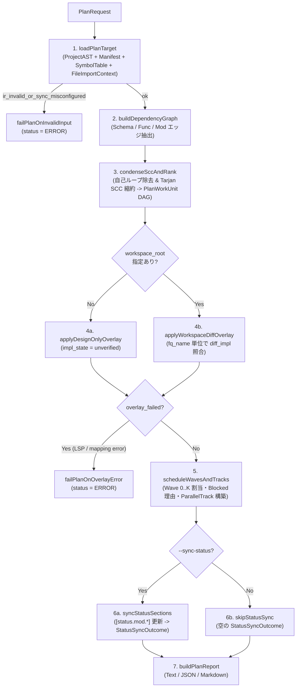

# `surc plan` Specification v0.1

- **Status**: Draft v0.1
- **Last Updated**: 2026-11-18
- **Compatibility**: Surv IR v1.1 (`Spec-Surv-IR-v1.1.md`)

---

## 1. 概要

`surc plan` は、Surv IR（単一 `.toml` または `surv.toml` プロジェクト）に記述されたアーキテクチャ依存グラフを解析し、必要に応じて実際のコードベースとのドリフト検出（`surc diff`）を重ね合わせることで、**実装順序（Wave）・今すぐ着手可能なタスク（Ready）・ブロッカー（Blocked）・並列実装トラック（Parallel Tracks）**を自動導出するコマンドである。

### 主要目標
1. **ゼロ手動メンテナンス**: 手書きの `TODO.md` や `progress.toml` を不要にし、IR グラフと現在の実装コードからリアルタイムに進捗と次の一手を算出する。
2. **相互再帰・自己再帰への耐性**: 自己参照型（例: `ExprAST.children = "schema.ExprAST[]"`）や相互再帰スキーマを強連結成分（SCC）縮約によって厳密な DAG に変換し、破綻なくトポロジカル順序を決定する。
3. **並列開発（マルチエージェント／チーム分担）の最大化**: 「境界スキーマ（型定義）の確定」と「各モジュール内の関数実装」を分離し、独立して並列実装可能なトラックを明示する。
4. **`[status]` セクションとの自動同期**: `--sync-status` 指定時に、実コードとの照合結果からモジュールごとの `state` と `coverage` を自動算出・更新する。

---

## 2. CLI インターフェース

```bash
surc plan <design.toml|surv.toml> [workspace_root] [options]
```

### オプション
| オプション | 説明 | 既定値 |
| :--- | :--- | :--- |
| `--mod <module>` | 特定モジュールとその参照閉包（依存先 Schema / Func / Mod）にスコープを限定 | 全モジュール |
| `--lang <lang>` | 実装照合時の対象言語（`rust`, `ts`, `c`, `zig`, `both`, `all`） | `both` |
| `--strategy <str>` | ワークスペース解析戦略（`static` または `lsp`） | `static` |
| `--mapping <file>` | シンボル対応表（`.surv/mapping.toml`）のパス | なし |
| `--sync-status` | ワークスペース照合結果に基づき IR ファイル内の `[status.mod.*]` を更新（`workspace_root` 指定時のみ有効） | `false` |
| `--format <fmt>` | 出力形式（`text`, `json`, `md`） | `text` |

> **制約:** `workspace_root` を省略した「設計単独モード（Design-Only Mode）」で `--sync-status` が指定された場合は、実装根拠がないため静的設定エラー（終了コード `1`）とする。

---

## 3. 処理パイプラインと短絡契約



### 早期終了（Short-Circuit）契約
1. **入力検証段階（`failPlanOnInvalidInput`）**: `surv.toml` の破損、IR ファイルの TOML 構文エラー、`check_surv_file` / `check_project` における静的エラー（未定義参照や `require` 循環依存など）、または `workspace_root` なしでの `--sync-status` 指定時は、グラフ構築を行わず直接 `status = "ERROR"` の `PlanReport` を返す。
2. **ワークスペース照合段階（`failPlanOnOverlayError`）**: `--mapping` ファイルの構文不正や `--strategy lsp` での LSP 起動失敗など、ワークスペース解析自体が失敗した場合も、誤って全シンボル未実装（`missing`）と判定せず `status = "ERROR"` の `PlanReport` へ短絡する。

---

## 4. 依存グラフと SCC 縮約の意味論

### 4.1 ノード（`PlanNode`）
計画対象のシンボルは、既存の `SymbolTable` による正規 `fq_name` で一意に識別される以下の3種類である：
- `schema.*`
- `func.*`
- `mod.*`（各モジュールのパイプライン結合・境界統合タスクを表す）

### 4.2 依存エッジの分類（Hard Blocker vs Pipeline Hint）

| エッジ種別 | 向き（`dependent -> dependency`） | 意味 | Blocker 扱い |
| :--- | :--- | :--- | :---: |
| **`schema_ref`** | `schema.A -> schema.B` | `A` の `fields` / `from` / `to` / `base` / `over` が定義済み `schema.B` を参照（プリミティブ型や外部標準型 `String`, `PathBuf` 等は除外） | **Hard** |
| **`func_io_schema`** | `func.F -> schema.S` | `F` の `input` または `output` が `schema.S` を参照（関数のシグネチャ定義に入出力型が必要） | **Hard** |
| **`mod_member`** | `mod.M -> schema.S / func.F` | モジュール `M` の統合完了には所属する全 `schemas` / `funcs` の実装が必要 | **Hard** |
| **`mod_hierarchy`** | `mod.Parent -> mod.Parent.Child` | `submods` で宣言された子モジュールへの依存 | **Hard** |
| **`mod_require`** | `mod.M -> mod.Required` | ファイル先頭 `require = ["mod.*"]`（`NormalizedRequire`）による外部モジュール依存 | **Hard** |
| **`pipeline_order`** | `func.Downstream -> func.Upstream` | 同一 `mod.M.pipeline` 内の直列ステップ `Upstream -> Downstream`。実装時の推奨順および結合テスト順を示すが、入出力 `schema.*` が定義済みであれば関数単体の並列実装は妨げない | **Soft（推奨順）** |

### 4.3 自己参照の除去と強連結成分（SCC）縮約による DAG 保証
1. **自己ループの除去**: `ExprAST.children = "schema.ExprAST[]"` のような自己参照（`u == v`）は、単一の構造体定義内で完結するため外部依存エッジから除外する。
2. **Tarjan SCC 縮約と DAG 性**:
   - Hard エッジの向きは `Mod -> {Mod, Func, Schema}`、`Func -> Schema`、`Schema -> Schema` の階層構造を持つため、`Schema` と `Func` の間や `Func` 同士で閉路が生じることはない。
   - 相互再帰する `Schema` 群（例: `schema.Expr <-> schema.Stmt`）は Tarjan SCC により単一の **`PlanWorkUnit`**（`unit_kind = "schema_scc"`, `member_nodes = [...]`）に縮約する。
   - `Mod` 間の閉路はプロジェクト検査（`check_project`）で事前に弾かれるが、単一ファイル入力時にも `mod.*` を複数含む SCC が検出された場合は循環モジュールエラーとして診断報告する。これにより縮約後の `PlanWorkUnit` グラフは**常に閉路のない厳密な DAG** となる。

---

## 5. ワークスペース照合（Overlay）と状態分類

### 5.1 パッケージ境界を保持したシンボル照合と実装状態（`impl_state`）
`workspace_root` が指定された場合、別パッケージにある同名シンボル（例: `pkg.a` の `schema.Error` と `pkg.b` の `schema.Error`）が衝突しないよう、`ExpectedSymbol.stable_id` に正規 `fq_name` を付与した上でファイル／パッケージ文脈ごとに `diff_impl` の照合ロジックを実行し、各 `PlanNode`（`schema.*` / `func.*`）に以下の状態を付与する：

| `impl_state` | 判定条件 | 計画上の扱い |
| :--- | :--- | :--- |
| **`done`** | 対象言語スコープ内であり、コード上で一意にマッチし、`SignatureMismatch` も `SchemaFieldMismatch` も存在しない | **完了済み**（下流の Blocker を解除） |
| **`drifted`** | コード上で一意にマッチしたが、引数・戻り値型またはフィールド定義に不一致（Mismatch）がある | **要修正タスク**（`drift_problems` を表示。下流に対しては未完了＝Blocker となる） |
| **`ambiguous`** | コード上に複数の候補シンボルが見つかり一意に特定できない | **要マッピング／`impl.path` 明示タスク**（未完了扱い） |
| **`missing`** | コード上にシンボルが存在しない | **新規実装タスク**（未完了扱い） |
| **`out_of_scope`** | `--lang rust` 指定時に `impl.lang = "ts"` である等、今回の言語フィルタ対象外 | 進捗母数から除外し、他シンボルをブロックしない |
| **`unverified`** | `workspace_root` 省略時、または型情報を一意に解釈できない場合 | 全シンボルを未検証として Wave 1 以降に配置。差分（drift）とは区別し、done にはしない |

### 5.2 モジュール統合ユニット（`mod.*` / `mod_integration`）の状態導出
`diff_impl` が直接照合するのは `schema.*` と `func.*` であり、`mod.*`（`unit_kind = "mod_integration"`）はコード上の単一シンボルを持たないため、以下の規則で状態を導出する：
1. `[status.mod.<M>].state == "blocked"` が手動設定されている場合 → 常に **`blocked`**（Wave 上も下流モジュールの Blocker として維持）。
2. Hard 依存先（所属 `schemas`・`funcs`、子 `submods`、`require` 先 `mod.*`）に1つでも未完了（`missing` / `drifted` / `ambiguous`）がある場合 → **`blocked`**。
3. Hard 依存先がすべて `done` である場合：
   - 対象スコープ内の所属シンボルまたは子モジュールが 1 つ以上存在すれば **`done`**（Wave 0）。
   - 所属シンボルも子モジュールも 0 個の空モジュール（プレースホルダ）である場合は、空集合による誤完了を防ぐため `[status.mod.<M>].state == "done"` が明示されていない限り **`ready`**（Wave 1 / `todo`）とする。

---

## 6. Wave スケジューリングと並列トラック導出

### 6.1 Readiness（着手可能性）と Wave 番号の計算
各 `PlanWorkUnit` $u$ の Hard 依存先集合を $\text{Deps}_{\text{hard}}(u)$ とする：

1. **Wave 0（Completed Foundation）**:
   `workspace_root` 指定時、構成シンボルがすべて `done`（または `out_of_scope`）である `PlanWorkUnit` を **Wave 0** とする。
2. **未完了ユニットの Wave 番号（$1 \dots K$）**:
   未完了の依存先集合を $\text{IncompleteDeps}(u) = \{ d \in \text{Deps}_{\text{hard}}(u) \mid d \notin \text{Wave } 0 \}$ とする。
   - $\text{IncompleteDeps}(u) = \emptyset$ のとき:
     - **`readiness = "ready"`**（今すぐ着手可能）、**`wave_index = 1`**。
   - $\text{IncompleteDeps}(u) \neq \emptyset$ のとき:
     - **`readiness = "blocked"`**（`blocked_by` に $\text{IncompleteDeps}(u)$ の ID 一覧を記録）。
     - **`wave_index = 1 + max_{d in IncompleteDeps(u)} wave_index(d)`**。
   - 依存先は完了しているが、型照合が `unverified` の unit:
     - **`readiness = "unverified"`**、**`wave_index = 1`**。
     - `ready` / `blocked` の件数には含めず、`unverified_unit_count` に計上する。

この定義により、**同一 Wave 番号に属するすべての `PlanWorkUnit` は互いに Hard 依存を持たず、完全に並列実行可能**であることが保証される。

### 6.2 並列トラック（`ParallelTrack`）の抽出
境界スキーマ群（複数モジュールから参照される共有 `schema.*`）の定義が完了した後、各モジュール `mod.*`（または `impl.path` プレフィックス）ごとに所属する未完了 `func.*` とモジュール専用 `schema.*` を `pipeline_order` 順に並べたものを **`ParallelTrack`** として出力する。これにより、複数エンジニアや複数の AI エージェントへモジュール単位で安全に作業を分割できる。

### 6.3 複数モジュールで共有されるシンボルの扱い
ある `schema.S` や `func.F` が複数のモジュール（例: `mod.frontend` と `mod.explorer` の境界にある `schema.FrontendOutcome`）から参照されている場合：
- Wave 表では重複させず 1 つの `PlanWorkUnit`（共有基盤）として一度だけ計上し、`referenced_by_mods` に参照元モジュール一覧を保持する。
- モジュール別の進捗集計（および `--sync-status`）では、各モジュールが参照する `schemas` + `funcs` のうち `done` になっている割合としてモジュール単位の `coverage` を算出する。

---

## 7. `--sync-status` による `[status]` 自動更新規則

`workspace_root` と `--sync-status` がともに指定された場合、各モジュール `mod.M` について対象言語スコープ内の所属 `schemas`（$S_M$）と `funcs`（$F_M$）の `done` 数から `[status.mod.<M>]` を更新する：

- **カバレッジ**: $\text{coverage} = \frac{|\text{done}(S_M)| + |\text{done}(F_M)|}{|S_M| + |F_M|}$（対象シンボルが 0 個の場合は子モジュール平均、それもなければ `0.0`）
- **状態（`state`）の自動導出**（既存の `state` が手動で `"blocked"` に設定されている場合は上書きせず保持する）：
  1. $|S_M| + |F_M| > 0$ かつ全シンボルが `done`（`drifted == 0`、`unverified == 0`） → **`"done"`**
  2. $|\text{done}(S_M)| + |\text{done}(F_M)| == 0$ かつ `drifted == 0`、`unverified == 0` → **`"todo"`**
  3. $|S_M| > 0$ かつ全 $S_M$ が `done` だが $|F_M| > 0$ で $|\text{done}(F_M)| == 0$ → **`"skeleton"`**（型定義のみ完了）
  4. 上記以外（一部実装済み、または `drifted` / `ambiguous` / `unverified` あり） → **`"partial"`**
- **書込失敗時の扱い**: ファイルの権限不足等で `[status]` の書き戻しに失敗した場合は、`StatusSyncOutcome.has_errors = true` として診断を記録し、算出された Wave 計画自体は保持しつつ最終 `PlanReport.status` を `"ERROR"`（終了コード `1`）とする。

`unverified` は drift ではないため `drift_rate` や失敗終了コードには含めませんが、`done` として扱わず、plan の `unverified_symbols` / `unverified_unit_count` に計上します。型の未検証が解消されるまで、そのシンボルに依存するモジュールは完了扱いにしません。
